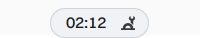
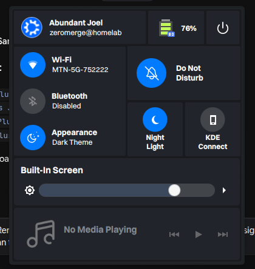
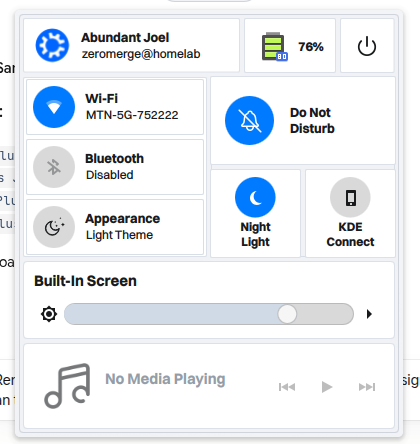
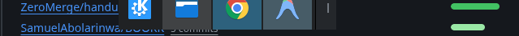
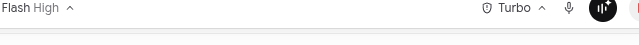
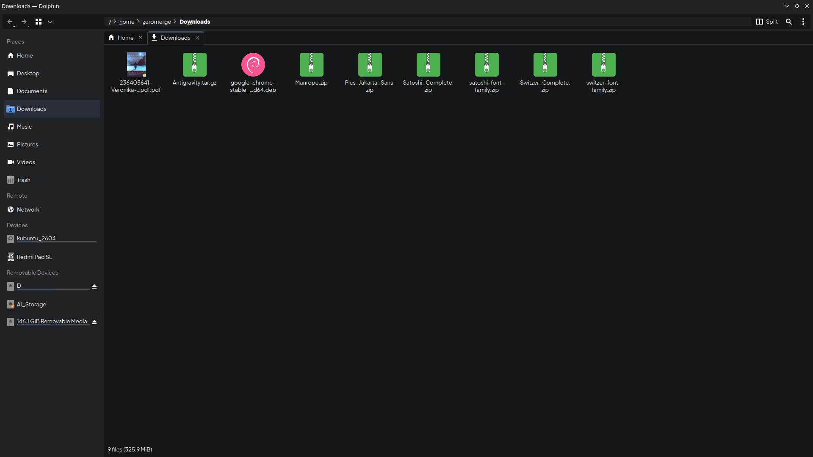
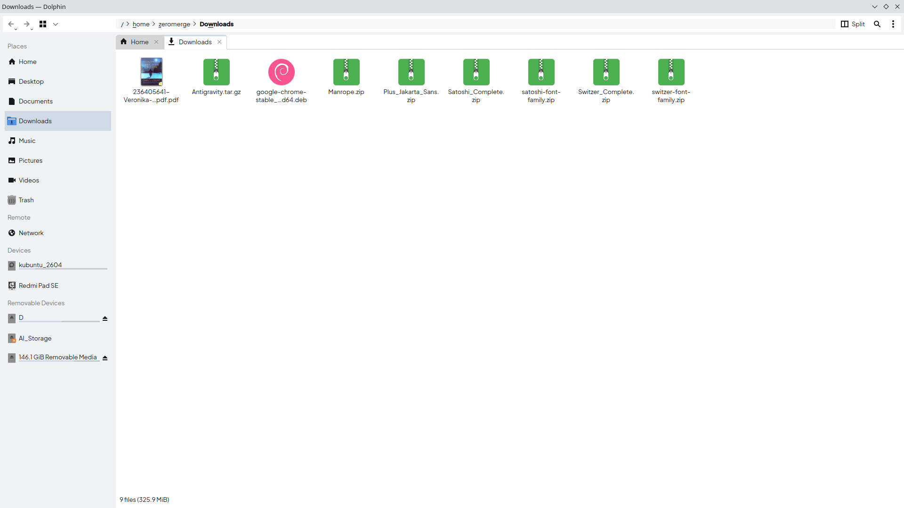
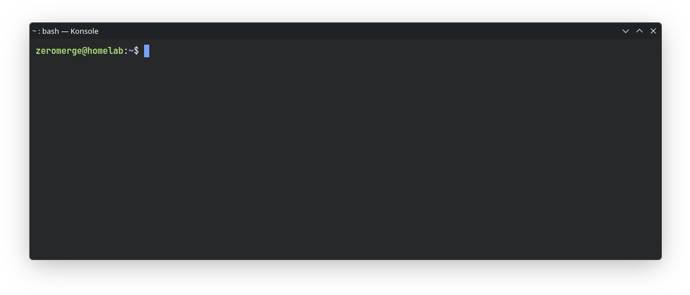
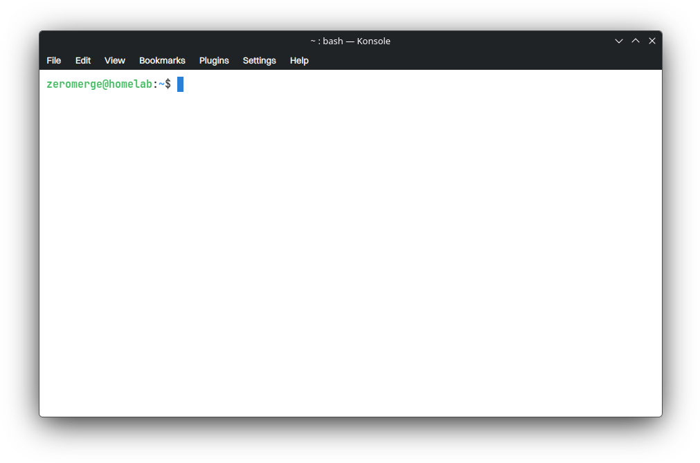

# Modern Desktop Suite for Kubuntu / KDE Plasma 6 (Wayland)

A complete, battle-tested, modular desktop suite for Kubuntu 26.04 LTS running KDE Plasma 6 on Wayland.
Includes dual-theme instant switching (Dark & Light), adaptive Dynamic Island capsule, flush-fit bottom floating dock, custom Dolphin file explorer stylesheets, Konsole terminal theme with JetBrains Mono, KWin quarter-tiling window snapping, Bibata Modern Ice cursors, GTK 3/4 synchronization, and seamless lockscreen wallpaper matching.

---

## Visual Architecture Overview

```
┌────────────────────────────────────────────────────────┐
│             [ 01:45  •  (Switch Toggle) ]              │  <-- Adaptive Dynamic Island Capsule
│                                                        │      (Porcelain Light #f0f2f5 <-> Deep Charcoal #181a1e)
│                                                        │
│                                                        │
│                     Active Windows                     │  <-- Standard titlebars with full min/max/close controls
│                                                        │      Diffused 80-alpha soft ambient drop shadows
│                                                        │      Quarter-screen & 50/50 magnetic snapping
│                                                        │
│       [ Kickoff | Files | Chrome | Code | [|] ]         │  <-- Bottom Floating Dock
└────────────────────────────────────────────────────────┘      (14px Left Curve, 0px Flush-Right Activator)
```

---

## Visual Component Gallery

### 1. Dynamic Island Capsule & Control Center Dropdown
*Real-time ITU-R BT.601 perceptual luminance tracking morphs capsule between deep charcoal and porcelain light.*

| Dynamic Island (Dark Mode) | Dynamic Island (Light Mode) |
| :---: | :---: |
| **Top Adaptive Capsule** | **Top Adaptive Capsule** |
|  |  |
| **Island Dropdown / Control Center** | **Island Dropdown / Control Center** |
|  |  |

### 2. Bottom Floating Dock
*Curved floating dock with 14px kickoff offset and 0px flush-right activator pin.*

| Bottom Floating Dock (Dark Mode) |
| :---: |
|  |
| **Bottom Floating Dock (Light Mode)** |
|  |

### 3. Dolphin File Explorer
*Custom Qt6 QSS stylesheets featuring rounded slate-blue selection pills, crisp porcelain path bars, and readable text pens.*

| Dolphin Dark Mode (`dolphin-dark.qss` + Plus Jakarta Sans) | Dolphin Light Mode (`dolphin-light.qss` + Plus Jakarta Sans) |
| :---: | :---: |
|  |  |

### 4. Konsole Terminal Suite
*JetBrains Mono Nerd Font, 92% deep charcoal opacity (#141618), 96% light opacity (#ffffff), Gaussian window blur, and hidden menubar.*

| Konsole Terminal (ModernDark Profile) | Konsole Terminal (ModernLight Profile) |
| :---: | :---: |
|  |  |

---

## Feature Matrix & Component Details

### 1. Dual-Theme Live Switcher (`desktop-theme`)
- **1-Click Bidirectional Toggle**: Controlled via CLI (`desktop-theme toggle`) or directly via the **Appearance** tile inside **KdeControlStation**.
- **Synchronized Subsystems**:
  - Plasma Color Scheme (`ModernLight` $\leftrightarrow$ `ModernDark`)
  - Desktop Theme (`modern-dock-light` $\leftrightarrow$ `modern-dock`)
  - Dynamic Island Pill (`#f0f2f5` with `#d0d4dc` border $\leftrightarrow$ `#181a1e` with `#282a30` border)
  - Control Station popup and cards (`#ffffff` cards on `#f0f2f5` $\leftrightarrow$ `#21242b` cards on `#181a1e`)
  - Dolphin File Explorer (`dolphin-light.qss` $\leftrightarrow$ `dolphin-dark.qss`)
  - Konsole Terminal Profiles (`ModernLight.profile` $\leftrightarrow$ `ModernDark.profile`)
  - GTK 3 & GTK 4 themes (`Breeze` $\leftrightarrow$ `Breeze-Dark`)
  - XDG Desktop Portal / GNOME interface (`prefer-light` $\leftrightarrow$ `prefer-dark`)
  - Icons (`Papirus` $\leftrightarrow$ `Papirus-Dark`)
  - Lockscreen Wallpaper (`Flow` light $\leftrightarrow$ `DarkestHour` dark)

### 2. Dolphin File Explorer Fixes
- **Crisp Porcelain Breadcrumbs (`KUrlNavigator`)**: Replaced unstyled black path bar with clean `#f0f2f5` / `#ffffff` background and `#181a1c` dark text.
- **Floating Rounded Selection Pill**: Replaced full-width rectangular teal block with a soft slate-blue floating rounded pill (`#d0dae6` / `rgb(208,218,230)`) with 10px lateral margins.
- **Readable Highlight Text Pen**: Fixed upstream white-on-light bug by setting `ForegroundActive=24,26,28` in `ModernLight.colors`.
- **D-Bus Single-Instance Wrapper**: `~/.local/bin/dolphin` and `~/.local/share/applications/org.kde.dolphin.desktop` guarantee that Dolphin always launches with `-stylesheet ~/.config/dolphin.qss`.

### 3. Adaptive Dynamic Island Capsule (`Panel.qml`)
- **Perceptual Luminance Formula**: Dynamically monitors `(r*0.299 + g*0.587 + b*0.114) > 0.5` on the desktop background, adapting capsule fill and border colors in real-time.
- **Dock 0px Flush-Right Pin**: Bottom dock activator tile (`DockPin`) is flush with the right outer border with zero gap, and 14px curve offset on the left.

### 4. Terminal & Konsole Suite
- **JetBrains Mono Nerd Font**: Installed to `~/.local/share/fonts/JetBrainsMono/` with complete ligatures, dev glyphs, and git symbols.
- **Deep Dark & Light Profiles**:
  - `ModernDark.profile`: `#141618` background, 0.92 opacity, active KWin Gaussian blur, Tokyo Night/Catppuccin hybrid ANSI 16 palette.
  - `ModernLight.profile`: `#ffffff` background, 0.96 opacity, blur enabled, vibrant day palette.
- **Minimalist Chrome**: Top menubar hidden by default (accessible via `Ctrl+Shift+M`), 10px comfortable terminal padding.

### 5. Window Behavior, Snapping & Desktop Polish (KWin)
- **Standard Titlebars Preserved**: Window titlebars and window control buttons (min/max/close) remain fully visible and interactive when windows are maximized.
- **Magnetic Snapping**: Drag to top edge to maximize; drag to left/right for 50/50 split; drag to any corner for 25% quarter tiling.
- **Diffused Ambient Drop Shadows**: Configured `~/.config/breezerc` with `ShadowSize=ShadowLarge` and `ShadowStrength=80` for smooth ambient diffusion.
- **Alt + Tab Balanced Thumbnail Grid (`thumbnail_grid`)**: Custom balanced card grid switcher displaying live window previews (`KWin.WindowThumbnail`), header application icons, window titles, and interactive highlight borders with uniform 14px spacing and non-jagged row/column alignment (`~/.local/share/kwin/tabbox/thumbnail_grid/` & `~/.config/kwinrc [TabBox]`).
- **Snappy 0.5x Window Animations**: Configured `AnimationDurationFactor=0.5` in `~/.config/kdeglobals` for instant, high-refresh-rate window transitions without floaty delays.
- **Floating Spotlight Search (KRunner)**: Centered floating search modal (`~/.config/krunnerrc [General] FreeFloating=true`) on `Alt + Space`.
- **Subtle Acoustic Audio Feedback**: Enabled modern `ocean` sound theme with volume change pops (`plasmaparc`) and disabled harsh legacy system bell beeps (`kaccessrc`).

### 6. Cursor & GTK / Flatpak Synchronization
- **Cursor**: `Bibata-Modern-Ice` configured across `kcminputrc`, `kdeglobals`, `~/.icons/default/index.theme`, and GTK 3/4 settings.
- **GTK 3 & 4**: Synchronized with `Plus Jakarta Sans 10` font, `Papirus-Dark` icons, and `Breeze-Dark` theme.
- **GNOME Portal Interface**: `gsettings` emits `prefer-dark` / `prefer-light` so third-party apps (Chrome, VS Code, Discord, Flatpaks) switch themes on the fly.

### 7. Seamless Lock Screen & SDDM
- **Lock Screen**: Synchronized with the desktop wallpaper via `kscreenlockerrc` (`DarkestHour` in dark mode, `Flow` in light mode).
- **SDDM Greeter**: Configuration in `/etc/sddm.conf.d/20-kubuntu.conf` matching cursor and replacing the default Kubuntu gear splash.

### 8. Typography Suite & Multi-Font Switcher
- **Modern Typography Suite**: Complete OTF/TTF font suites bundled for `Plus Jakarta Sans` (active default), `Manrope`, `Switzer`, and `Inter`.
- **Live CLI Switcher (`desktop-font-switcher` / `switch-font`)**: Instantly updates KDE Plasma (`kdeglobals`), GTK 3 (`settings.ini`), GTK 4 (`settings.ini`), and XDG GNOME Interface:
  ```bash
  switch-font jakarta      # Switch to Plus Jakarta Sans
  switch-font manrope      # Switch to Manrope
  switch-font switzer      # Switch to Switzer
  switch-font inter        # Switch to Inter
  ```

---

## Directory Structure

```
kde-desktop-playbook/
├── README.md                          # High-level overview & visual gallery
├── ARCHITECTURE.md                    # Deep technical manual & upstream bugfix guide
├── install.sh                         # Turnkey modular deployment tool
├── desktop.yml                        # Ansible playbook for headless automation
├── inventory.ini                      # Ansible localhost connection definition
│
├── docs/
│   └── images/                        # High-resolution component screenshots
│       ├── island_capsule.png         # Dynamic island pill (Dark)
│       ├── island_capsule_light.png   # Dynamic island pill (Light)
│       ├── island_dropdown.png        # Control Station dropdown (Dark)
│       ├── island_dropdown_light.png  # Control Station dropdown (Light)
│       ├── bottom_dock.png            # Floating dock (Dark)
│       ├── bottom_dock_light.png      # Floating dock (Light)
│       ├── dolphin_explorer.png       # Dolphin file manager (Dark)
│       ├── dolphin_explorer_light.png # Dolphin file manager (Light)
│       ├── konsole_terminal.png       # Konsole terminal suite (Dark)
│       └── konsole_terminal_light.png # Konsole terminal suite (Light)
│
├── files/                             # Exact source files matching target paths
│   ├── applications/                  # Desktop entries (Dolphin wrapper)
│   ├── bin/                           # Executable scripts (desktop-theme, dolphin)
│   ├── color-schemes/                 # ModernDark.colors, ModernLight.colors
│   ├── configs/                       # dolphinrc, kdeglobals, user-places.xbel
│   ├── cursor/                        # Bibata-Modern-Ice cursor suite & X11 index.theme
│   ├── dolphin/                       # QSS stylesheets (light, dark, active)
│   ├── fonts/                         # JetBrains Mono, Plus Jakarta Sans, Manrope, Switzer, Inter
│   ├── gtk/                           # GTK 3.0 and GTK 4.0 settings.ini
│   ├── konsole/                       # Konsole color schemes, profiles, and konsolerc
│   ├── kwin/                          # kwinrc (quarter snapping) & breezerc (shadows)
│   ├── lockscreen/                    # kscreenlockerrc wallpaper configurations
│   ├── plasmoids/                     # KdeControlStation, org.kde.plasma.dockpin, etc.
│   ├── scripts/                       # desktop-font-switcher CLI tool
│   ├── sddm/                          # 20-kubuntu.conf & kubuntu-theme.conf
│   ├── shell/                         # Panel.qml with luminance detection
│   └── themes/                        # modern-dock & modern-dock-light desktop themes
```

---

## Quick Start & Usage

### 1. Full Deployment
To deploy or restore the entire suite at once:
```bash
./install.sh --all
```

### 2. Selective Modular Deployment
To update or restore only specific components:
```bash
./install.sh --fonts        # Deploy Plus Jakarta Sans, Manrope, Switzer, Inter & font switcher
./install.sh --theme        # Deploy color schemes, modern-dock themes, and switcher
./install.sh --dolphin      # Deploy Dolphin QSS stylesheets, wrapper, and desktop entry
./install.sh --konsole      # Deploy Konsole profiles, colorschemes, and JetBrains Mono
./install.sh --kwin         # Deploy KWin snapping and soft shadows
./install.sh --cursor       # Deploy Bibata Modern Ice cursor and X11 inheritance
./install.sh --gtk          # Deploy GTK 3/4 settings and GNOME interface portal
./install.sh --lockscreen   # Deploy lock screen wallpaper configuration
./install.sh --shell        # Deploy Panel.qml dynamic island and bottom dock
./install.sh --plasmoids    # Deploy Control Station and DockPin plasmoids
```

### 3. Font Switching
```bash
switch-font jakarta         # Apply Plus Jakarta Sans (default)
switch-font manrope         # Apply Manrope
switch-font switzer         # Apply Switzer
switch-font inter           # Apply Inter
```

### 3. Manual Inspection & Troubleshooting
See **[ARCHITECTURE.md](ARCHITECTURE.md)** for a line-by-line explanation of every component, root cause analysis of upstream KDE bugs, and manual recovery procedures.
